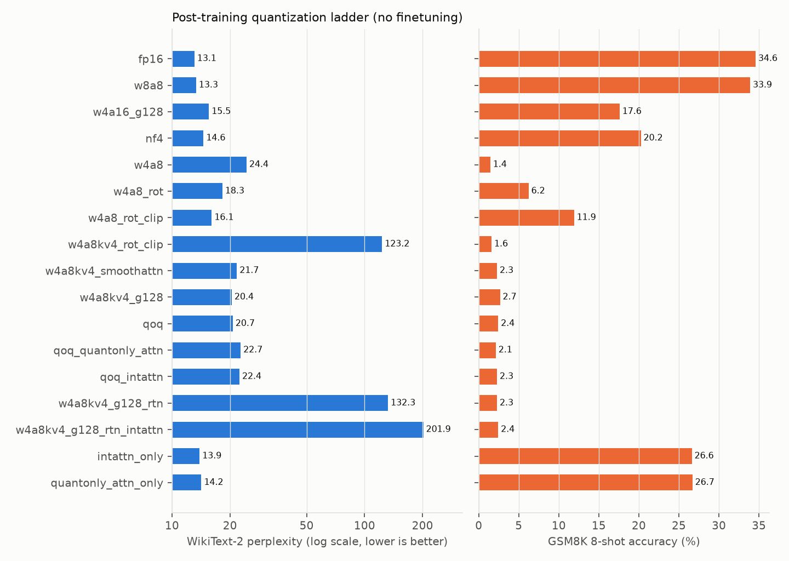

# What is the importance order of finetuning quantized models?

This repository contains our course project on **finetuning heavily quantized language models**. We take
Qwen2.5-0.5B and quantize it to a fully integer deployment target by combining two papers:

| Paper | What we use from it |
|---|---|
| **QServe / QoQ** (Lin et al., MLSys 2025) | W4A8KV4 quantization: progressive group quantization of weights (INT8 with a ±119 protective range, then UINT4 groups of 128), 8-bit per-token activations, 4-bit per-head KV cache, SmoothAttention, Hadamard rotation, block-output smoothing, weight clipping and channel reordering. |
| **IntAttention** (Zhong et al., MLSys 2026) | IndexSoftmax: INT8 Q/K/V, integer logits, clipping at a threshold c, a 32-entry UINT8 lookup table for the exponential and integer normalisation to UINT8 probabilities; also its "Quant-Only" baseline. |
| **LoRA / QLoRA / LoftQ** (background) | Low-rank adapters on a frozen quantized model, and LoftQ's initialisation from the quantization residual. |

We then ask in which order quantization and finetuning should be applied, which quantizers must be
active during training, and which parts of the quantization cause the damage that finetuning has to
repair. **The full write-up with all results is [`Report.md`](Report.md)**; how to run everything is in
[`INSTRUCTIONS.md`](INSTRUCTIONS.md).

## Results at a glance

We ran 62 experiments on an NVIDIA Tesla P100 (71.8 GPU-hours). All GSM8K comparisons below are tested
with paired McNemar tests over the 1,319 test questions.

| Question | Answer |
|---|---|
| Quantize first or finetune first? | **Quantize first, then finetune with the quantizers active**: 24.9–26.2% GSM8K, against 2.9% for finetune-then-quantize. The latter is no better than not finetuning at all (2.3%). |
| Which quantizers must be in the training loop? | **The 4-bit KV cache** (+16.8 pp). Adding 8-bit activations (+0.9 pp) or the integer softmax (−1.3 pp) makes no significant difference. |
| Which component causes the damage? | **KV4 > W4 ≫ integer softmax ≈ A8**, both before and after finetuning (Shapley attribution). LoRA repairs about 70% of the damage. |
| Merge the adapter into the weights? | **No.** Re-quantizing after merging loses 3.9–6.8 pp. |
| Remaining gap to full-precision LoRA | 11.3 pp (24.9% vs 36.2%); 4-bit-weights-only QLoRA is within 1.3 pp. |



## What is new in this project

* **A fully integer target.** QoQ's W4A8KV4 is stacked with IndexSoftmax, so every matrix
  multiplication and the whole attention path are integer. The simulation is bit-faithful: the integer
  products are computed exactly.
* **Quantization-aware LoRA through IndexSoftmax.** A straight-through estimator uses the integer
  attention in the forward pass and exact softmax attention for the gradient.
* **Training and deployment quantizers can be chosen separately**, which shows directly which
  quantizers must be present while training.
* **Shapley attribution** over a full 2⁴ factorial {W4, A8, KV4, IntAttention}, before and after
  finetuning.
* **Adapter deployment forms** compared: separate branch, merged into dequantized weights, or merged
  into the original weights and re-quantized.
* **Engineering for Qwen2.5:**
  * an exact Hadamard matrix of order 896 (Paley construction over GF(27) ⊗ Sylvester 32);
  * SmoothAttention and smoothing that handle grouped-query attention, QKV biases and RoPE;
  * a custom attention registered with HuggingFace, so KV4 and IndexSoftmax are also active during text
    generation.

## How it works

**Simulated integer quantization.** Each integer operation is simulated in PyTorch: values are mapped to
integer codes, rounded and clamped exactly as the papers specify, and mapped back. This works on any
GPU. Speed is not measured; the papers do that with their own kernels.

**Preparing the quantized model** (`qoq_intattn`):

```
offline:  fold RMSNorm scales -> Hadamard rotation of the residual stream
          -> calibrate on 128 x 512 C4 tokens -> SmoothAttention -> block-output smoothing
          -> per layer: reorder channels, search clipping ratios, progressive W4 group quantization
runtime:  INT8 activations -> W4 linear layers;  K, V stored as UINT4 per token and head
          attention: INT8 Q/K/V -> INT32 logits -> IndexSoftmax -> UINT8 P -> integer P.V
```

**Finetuning.** Every quantized linear layer can carry a LoRA adapter:

    y = Q_A(x) · Q_W(W)ᵀ + b  +  (α/r) · B A · Q_A(x)

Gradients flow through the activation and KV quantizers and through IndexSoftmax with the
straight-through estimator; the base weights stay frozen. The five pipelines are:

| pipeline | what happens |
|---|---|
| `fp_eval` | the full-precision model, no finetuning |
| `fp_ft` | LoRA on the full-precision model (upper bound) |
| `ptq_only` | quantization, no finetuning (lower bound) |
| `ft_then_ptq` | LoRA in full precision, merge, then quantize |
| `ptq_then_ft` | quantize, then train LoRA on the frozen quantized model |

**Protocol.**

* **Finetuning:** GSM8K, 1,000 steps at an effective batch of 16, LoRA rank 16 on all projections.
* **Evaluation:**
  * GSM8K exact match on all 1,319 test problems: 8-shot before finetuning, 0-shot after.
  * WikiText-2 perplexity.
  * Held-out loss.

## Repository layout

```
Report.md                 the project report (results, analysis, conclusions)
INSTRUCTIONS.md           how to set up and run everything (local GPU and SLURM cluster)
qft/                      the library
  config.py               run configuration and the named quantization presets
  runner.py               one experiment: pipeline x quantization x LoRA x seed -> result.json
  data.py, train.py       datasets, calibration data and the training loop
  evaluate.py, lora.py    evaluation (perplexity, GSM8K, lm-eval) and LoRA adapters
  quant/                  quantization: primitives, weight quantizers, Hadamard matrices, transforms,
                          calibration, integer attention, QuantLinear and the PTQ driver (apply.py)
scripts/                  run_experiment.py, launch.py, analyze.py, sanity_check.py, compute_importance.py
configs/                  base configurations and the experiment suites (rq0 ... rq5, smoke)
cluster/                  SLURM / Apptainer job scripts used on the GPU cluster
tests/test_qft.py         21 unit tests
results_cluster/          raw results of all 62 runs, REPORT.md, summary.csv and figures
```

## How we checked the implementation

**Unit tests.** The 21 unit tests (`python -m pytest -q tests/`) check that:

* the Hadamard matrices are exactly orthogonal;
* rotation, smoothing and SmoothAttention leave the model's outputs unchanged;
* our attention reproduces HuggingFace's, with and without padding and during cached generation;
* progressive group quantization never overflows its INT8 range;
* clipping and reordering do not increase the layer error;
* the integer attention is exact when computed in row slices;
* gradients reach only the adapters;
* merging works;
* the memory-efficient loss equals HuggingFace's.

**Consistency of the 62 runs.** Configurations that appear in two suites gave identical results, and
the rotated-but-unquantized model reproduces the full-precision perplexity and GSM8K answers exactly.

## Faithfulness to the papers

The numerics follow the papers' equations: rounding, clamping, the protective range, integer scales,
lookup-table values and the ×255 normalisation. The deliberate differences are:

* **Clipping objective.** Weight clipping minimises each layer's output error. QServe uses the block
  output error for q and k.
* **IndexSoftmax scales.** They are computed per sequence and head rather than per tensor, because we
  evaluate in batches. Padded positions are excluded.
* **Precision kept outside the integer path.** Embeddings and the output head stay in floating point.
  NF4 uses floating-point block scales without QLoRA's double quantization.
* **Adapter input.** The LoRA branch reads the same INT8 activation as the base layer, so it could run on
  the integer path. The FP-input variant is also tested.

Qwen3 is not supported: its per-head q/k normalisation prevents folding SmoothAttention into the weights.

## References

1. Y. Lin et al. *QServe: W4A8KV4 Quantization and System Co-design for Efficient LLM Serving.* MLSys 2025.
2. W. Zhong et al. *IntAttention: A Fully Integer Attention Pipeline for Efficient Edge Inference.* MLSys 2026.
3. T. Dettmers et al. *QLoRA: Efficient Finetuning of Quantized LLMs.* NeurIPS 2023.
4. E. J. Hu et al. *LoRA: Low-Rank Adaptation of Large Language Models.* ICLR 2022.
5. Y. Li et al. *LoftQ: LoRA-Fine-Tuning-Aware Quantization for Large Language Models.* ICLR 2024.
