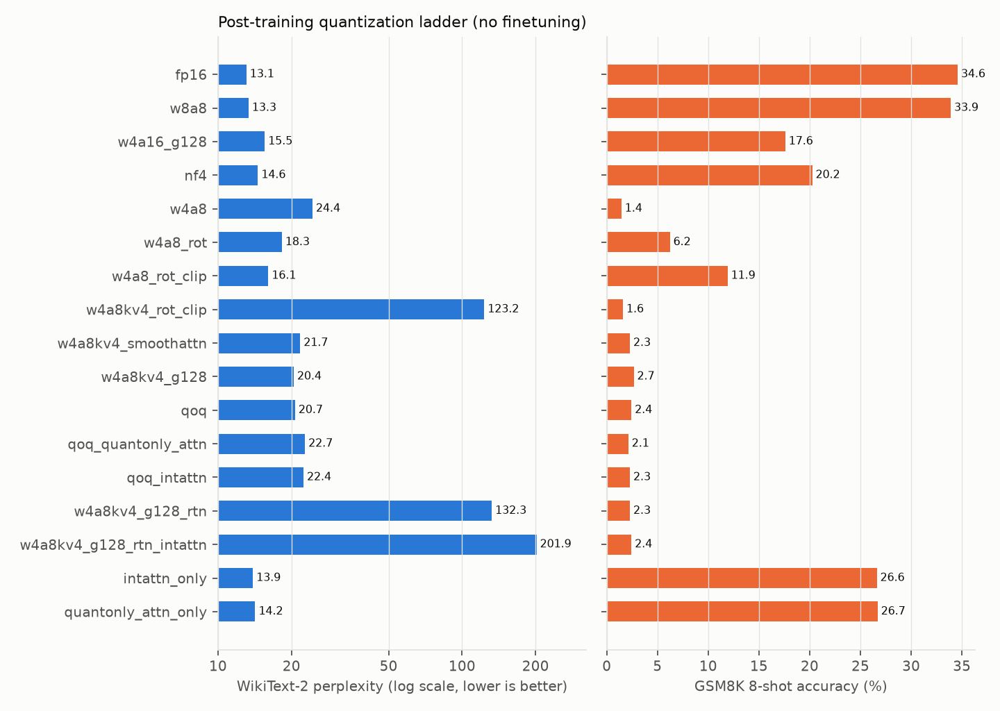
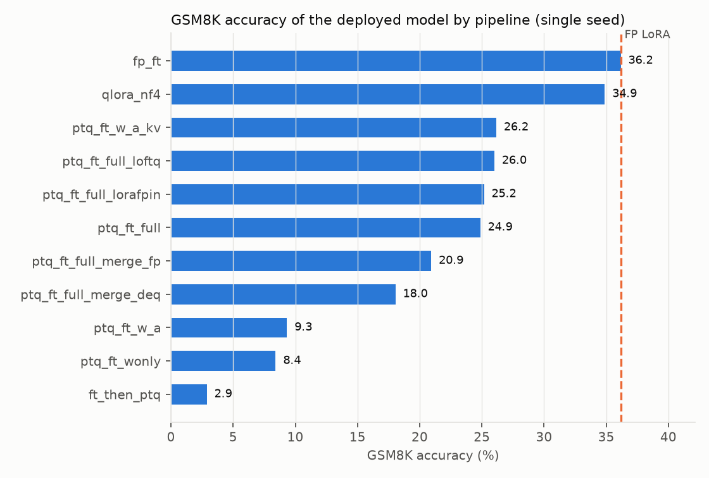
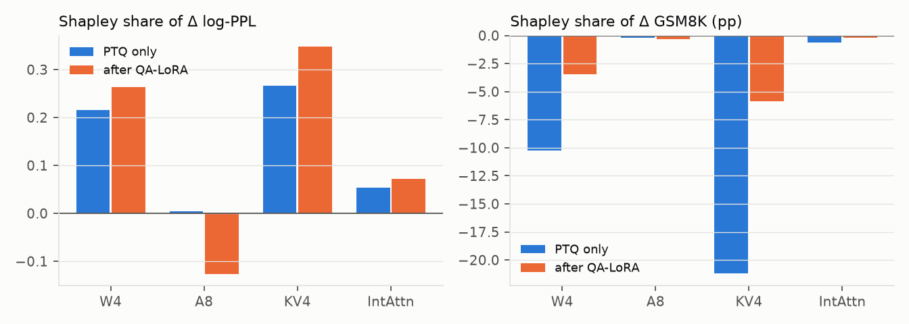

# Results report (auto-generated by scripts/analyze.py)

62 runs found (71.8 GPU-hours on Tesla P100-PCIE-16GB). Mean ± sample std over seeds; with one seed, GSM8K differences below about 2.5 pp are not significant on their own (see the McNemar tables).

## RQ0 — PTQ ladder (no finetuning)

GSM8K is 8-shot here (the base model is not instruction-tuned).

| config | WikiText-2 PPL ↓ | GSM8K 8-shot (%) ↑ | zero-shot avg (%) ↑ |
|---|---|---|---|
| fp16 | 13.07 | 34.57 | - |
| w8a8 | 13.34 | 33.89 | - |
| w4a16_g128 | 15.54 | 17.59 | - |
| nf4 | 14.57 | 20.24 | - |
| w4a8 | 24.38 | 1.44 | - |
| w4a8_rot | 18.26 | 6.22 | - |
| w4a8_rot_clip | 16.07 | 11.90 | - |
| w4a8kv4_rot_clip | 123.24 | 1.59 | - |
| w4a8kv4_smoothattn | 21.71 | 2.27 | - |
| w4a8kv4_g128 | 20.42 | 2.65 | - |
| qoq | 20.68 | 2.43 | - |
| qoq_quantonly_attn | 22.71 | 2.12 | - |
| qoq_intattn | 22.39 | 2.27 | - |
| w4a8kv4_g128_rtn | 132.30 | 2.27 | - |
| w4a8kv4_g128_rtn_intattn | 201.89 | 2.43 | - |
| intattn_only | 13.90 | 26.61 | - |
| quantonly_attn_only | 14.20 | 26.69 | - |

Paired significance of selected ladder steps (GSM8K):

| comparison | runs (a vs b) | Δ GSM8K (pp) | only a / only b correct | p (McNemar) | significant (5%) |
|---|---|---|---|---|---|
| W8A8 vs FP16 | `fp16` vs `w8a8` | +0.68 | 113 / 104 | 0.59 | no |
| NF4 vs RTN W4-g128 (weight-only) | `nf4` vs `w4a16_g128` | +2.65 | 148 / 113 | 0.035 | yes |
| + Hadamard rotation / smoothing | `w4a8_rot` vs `w4a8` | +4.78 | 77 / 14 | 1e-11 | yes |
| + weight clipping | `w4a8_rot_clip` vs `w4a8_rot` | +5.69 | 127 / 52 | 2e-08 | yes |
| IndexSoftmax on top of QoQ | `qoq` vs `qoq_intattn` | +0.15 | 31 / 29 | 0.9 | no |
| IndexSoftmax vs Quant-Only softmax | `qoq_intattn` vs `qoq_quantonly_attn` | +0.15 | 29 / 27 | 0.89 | no |
| IntAttention alone | `fp16` vs `intattn_only` | +7.96 | 191 / 86 | 2.5e-10 | yes |
| IndexSoftmax vs Quant-Only (FP weights) | `intattn_only` vs `quantonly_attn_only` | -0.08 | 98 / 99 | 1 | no |

## RQ1 — Order of operations (quantize ↔ finetune)

Deployment target for every row: QoQ W4A8KV4-g128 + IntAttention (except `fp_*`, `qlora_nf4`). `gap` = GSM8K difference to full-precision LoRA (pp).

| run | pipeline | GSM8K (%) | gap vs fp_ft | WikiText-2 PPL | zero-shot avg (%) | task val loss |
|---|---|---|---|---|---|---|
| fp_eval | fp_eval | 34.57 | - | 13.07 | - | - |
| fp_ft | fp_ft | 36.16 | +0.00 | 13.60 | - | 0.4314 |
| ft_then_ptq | ft_then_ptq | 2.88 | -33.28 | 23.50 | - | 0.8699 |
| ptq_ft_full | ptq_then_ft | 24.87 | -11.30 | 32.00 | - | 0.4979 |
| ptq_ft_full_loftq | ptq_then_ft | 26.00 | -10.16 | 22.31 | - | 0.4782 |
| ptq_ft_full_lorafpin | ptq_then_ft | 25.17 | -10.99 | 32.25 | - | 0.4943 |
| ptq_ft_full_merge_deq | ptq_then_ft | 18.04 | -18.12 | 39.50 | - | 0.5524 |
| ptq_ft_full_merge_fp | ptq_then_ft | 20.92 | -15.24 | 33.71 | - | 0.5253 |
| ptq_ft_w_a | ptq_then_ft | 9.33 | -26.84 | 33.09 | - | 0.6327 |
| ptq_ft_w_a_kv | ptq_then_ft | 26.16 | -10.01 | 33.78 | - | 0.4959 |
| ptq_ft_wonly | ptq_then_ft | 8.42 | -27.75 | 33.60 | - | 0.6446 |
| ptq_only | ptq_only | 2.27 | - | 22.39 | - | - |
| qlora_nf4 | ptq_then_ft | 34.87 | -1.29 | 14.90 | - | 0.4480 |

**Importance order of pipelines (GSM8K, best first):** `fp_ft` (36.2) > `qlora_nf4` (34.9) > `ptq_ft_w_a_kv` (26.2) > `ptq_ft_full_loftq` (26.0) > `ptq_ft_full_lorafpin` (25.2) > `ptq_ft_full` (24.9) > `ptq_ft_full_merge_fp` (20.9) > `ptq_ft_full_merge_deq` (18.0) > `ptq_ft_w_a` (9.3) > `ptq_ft_wonly` (8.4) > `ft_then_ptq` (2.9)

Paired significance of the key comparisons:

| comparison | runs (a vs b) | Δ GSM8K (pp) | only a / only b correct | p (McNemar) | significant (5%) |
|---|---|---|---|---|---|
| quantize first vs finetune first | `ptq_ft_full` vs `ft_then_ptq` | +21.99 | 315 / 25 | 4.9e-65 | yes |
| A8 added to the training loop | `ptq_ft_w_a` vs `ptq_ft_wonly` | +0.91 | 90 / 78 | 0.4 | no |
| KV4 added to the training loop | `ptq_ft_w_a_kv` vs `ptq_ft_w_a` | +16.83 | 276 / 54 | 5e-37 | yes |
| IndexSoftmax added to the training loop | `ptq_ft_full` vs `ptq_ft_w_a_kv` | -1.29 | 128 / 145 | 0.33 | no |
| LoftQ instead of standard LoRA init | `ptq_ft_full_loftq` vs `ptq_ft_full` | +1.14 | 146 / 131 | 0.4 | no |
| FP instead of INT8 input to the LoRA branch | `ptq_ft_full_lorafpin` vs `ptq_ft_full` | +0.30 | 134 / 130 | 0.85 | no |
| merge into FP weights + re-quantize | `ptq_ft_full_merge_fp` vs `ptq_ft_full` | -3.94 | 97 / 149 | 0.0011 | yes |
| merge into dequantized weights + re-quantize | `ptq_ft_full_merge_deq` vs `ptq_ft_full` | -6.82 | 78 / 168 | 9.6e-09 | yes |
| integer stack vs FP LoRA | `ptq_ft_full` vs `fp_ft` | -11.30 | 98 / 247 | 5.6e-16 | yes |
| NF4 QLoRA vs FP LoRA | `qlora_nf4` vs `fp_ft` | -1.29 | 135 / 152 | 0.34 | no |

Train/deploy mismatch: held-out GSM8K loss at the end of training, measured with the training-time quantizers, and the same loss on the deployed model. A large positive gap means the deployed model is not the one that was trained (gaps of a few thousandths are sampling noise: the training-time value uses 8 validation batches, the final one 16).

| run | val loss (training form) | val loss (deployed form) | gap |
|---|---|---|---|
| fp_ft | 0.432 | 0.431 | -0.000 |
| ft_then_ptq | 0.432 | 0.870 | +0.438 |
| ptq_ft_full | 0.500 | 0.498 | -0.002 |
| ptq_ft_full_loftq | 0.481 | 0.478 | -0.003 |
| ptq_ft_full_lorafpin | 0.497 | 0.494 | -0.003 |
| ptq_ft_full_merge_deq | 0.500 | 0.552 | +0.053 |
| ptq_ft_full_merge_fp | 0.500 | 0.525 | +0.025 |
| ptq_ft_w_a | 0.478 | 0.633 | +0.154 |
| ptq_ft_w_a_kv | 0.493 | 0.496 | +0.003 |
| ptq_ft_wonly | 0.479 | 0.645 | +0.165 |
| qlora_nf4 | 0.449 | 0.448 | -0.001 |

## RQ3a — Importance of each quantization component (Shapley decomposition)

Factors: W4 weights, A8 activations, KV4 cache, IntAttention softmax. The Shapley value splits the total metric change (all-on vs all-off) fairly among the factors, averaging over all orders in which they could be switched on, i.e. it accounts for interactions.

| stage | metric | unit | W4 | A8 | KV4 | IntAttn | total | damage order (worst first) |
|---|---|---|---|---|---|---|---|---|
| PTQ only | gsm8k_acc | Δ pp | -10.254 | -0.183 | -21.209 | -0.651 | -32.297 | KV4 > W4 > IntAttn > A8 |
| PTQ only | wikitext2_ppl | Δ log-PPL | +0.215 | +0.004 | +0.266 | +0.054 | +0.538 | KV4 > W4 > IntAttn > A8 |
| after QA-LoRA | gsm8k_acc | Δ pp | -3.450 | -0.341 | -5.850 | -0.215 | -9.856 | KV4 > W4 > A8 > IntAttn |
| after QA-LoRA | wikitext2_ppl | Δ log-PPL | +0.264 | -0.127 | +0.347 | +0.071 | +0.556 | KV4 > W4 > IntAttn > A8 |

Negative accuracy / positive log-PPL entries are damage attributed to that component. Comparing the PTQ and post-finetuning rows shows which damage finetuning repairs.

How much of each component's GSM8K damage quantization-aware LoRA repairs (for components that cost less than 1 pp the share is not meaningful and is left blank):

| component | Shapley before FT (pp) | after FT (pp) | repaired (pp) | repaired share |
|---|---|---|---|---|
| KV4 | -21.21 | -5.85 | +15.36 | 72% |
| W4 | -10.25 | -3.45 | +6.80 | 66% |
| IntAttn | -0.65 | -0.21 | +0.44 | - |
| A8 | -0.18 | -0.34 | -0.16 | - |

## Figures

